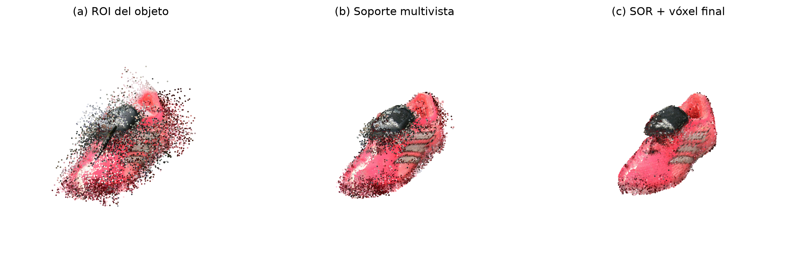
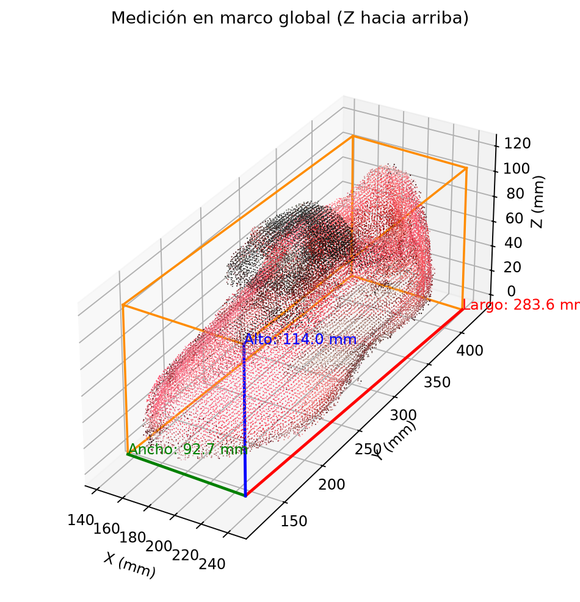

# Stereo 3D Reconstruction — Classical vs. Deep Learning

**A computer vision pipeline for reconstructing a real-world object in 3D from calibrated stereo images, combining geometric vision, neural stereo matching, and multi-view point cloud processing.**

This project reconstructs a colored 3D point cloud of a shoe using stereo image pairs. It explores two disparity estimation approaches: **StereoSGBM**, a classical stereo matching algorithm, and **CREStereo**, a deep learning-based stereo model.

The reconstruction pipeline also uses ChArUco-based pose estimation to align multiple observations in a common coordinate system and estimate the object's physical dimensions.

## Results



The documented reconstruction produced:

| Metric | Result |
|---|---|
| Final point cloud | 24,037 points |
| Estimated length | 283.6 mm |
| Estimated width | 92.7 mm |
| Estimated height | 114.0 mm |
| Stereo image resolution | 1280 × 720 |
| Valid poses used for neural reconstruction | 27 |

The measurements are estimates obtained from the reconstructed geometry, not independently verified ground-truth dimensions.



## Methodology

The pipeline consists of six main stages:

**1. Stereo calibration and rectification**

Calibrated camera parameters are used to rectify the left and right images, establishing the geometry required for stereo correspondence.

**2. Disparity estimation**

Two approaches are explored:

- **StereoSGBM:** classical semi-global block matching implemented with OpenCV.
- **CREStereo:** neural disparity estimation using ONNX Runtime, with CUDA acceleration when available.

**3. 3D reprojection**

Disparity maps are converted into 3D coordinates using the stereo reprojection matrix. Color information is preserved from the input images.

**4. Multi-view alignment**

ChArUco board detections provide camera poses, allowing local point clouds to be transformed into a shared reference frame.

**5. Point cloud refinement**

The reconstruction is refined using region-of-interest filtering, voxel downsampling, multi-view support filtering, and statistical outlier removal.

**6. Geometric measurements**

Principal Component Analysis and robust percentiles are used to estimate the object's dimensions in millimeters.

## Technologies

- Python
- OpenCV
- NumPy and SciPy
- Open3D
- ONNX Runtime
- CREStereo
- Jupyter Notebook

## Project Structure

```text
.
├── data/                    # Stereo images and calibration data
├── src/
│   ├── calibration.py
│   ├── dataset.py
│   ├── evaluation.py
│   ├── pointcloud.py
│   ├── pose.py
│   ├── stereo.py
│   ├── stereo_neural.py
│   └── visualization.py
├── outputs/                 # Reconstruction figures and point clouds
├── tp2_reconstruction.ipynb
├── requirements.txt
└── README.md
```

## Installation

Create a Python virtual environment and install the required dependencies:

```bash
python -m venv .venv
source .venv/bin/activate
pip install -r requirements.txt
```

On Windows, activate the environment using:

```powershell
.venv\Scripts\Activate.ps1
```

The documented project execution used Python 3.14.7.

## Usage

Launch the notebook:

```bash
jupyter lab tp2_reconstruction.ipynb
```

Run the cells sequentially from the repository root.

The notebook performs disparity estimation, pose estimation, multi-view reconstruction, point cloud filtering, and geometric measurement.

The neural reconstruction may require downloading the ONNX model during its first execution.

## Outputs

The repository includes reconstructed point clouds and visualization files under `outputs/`.

The final neural reconstruction is available as:

`outputs/shoe_final_dl.ply`

The PLY file can be opened with compatible 3D visualization software, including Open3D.

## Academic Context

Developed as a Computer Vision academic project focused on stereo geometry, 3D reconstruction, and the integration of classical and learning-based vision techniques.
